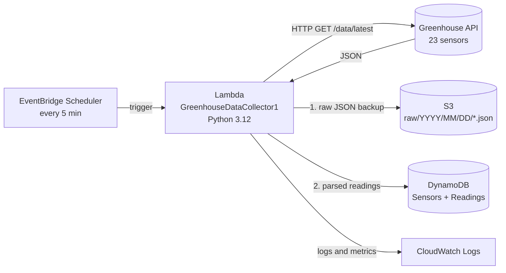

# Serverless Digital Twin for a Smart Greenhouse (AWS)

A serverless data-ingestion pipeline that polls a greenhouse sensor API every five minutes, backs up every raw response to S3, and stores the parsed time-series readings (23 sensors, about 6,600 readings per day) in DynamoDB, with CloudWatch logging for monitoring.

Built for the IJC308 module (University of Sheffield), January 2026.

## Architecture



Everything runs in `us-east-1`. There are no servers to manage and nothing runs between polls.

## How a run works

1. **Load metadata:** read the 23 sensor definitions from the `Sensors` table (cached for warm invocations).
2. **Fetch:** `GET /data/latest?count=1`, retrying up to 3 times with exponential backoff (1 s, then 2 s between attempts).
3. **Validate:** reject responses with a missing or empty `data` field (logged, HTTP 500 returned).
4. **Back up first:** write the untouched JSON to `s3://<bucket>/raw/YYYY/MM/DD/<epoch>_<run_id>.json` before any parsing.
5. **Parse:** convert the ISO timestamp to a Unix epoch, extract the day, and convert floats to `Decimal`. Null values are skipped.
6. **Store:** write one DynamoDB item per sensor. A failure on one sensor is logged and counted but does not stop the others.
7. **Report:** return `{statusCode, run_id, records, failed, s3_key}` and log the summary to CloudWatch.

## Database design

| Table | Key | Attributes |
|---|---|---|
| **Sensors** (23 items, static) | PK `sensor_key` (String) | `display_name`, `unit`, `category` |
| **Readings** (about 6,600 new items/day) | PK `sensor_id` (String), SK `ts` (Number, Unix epoch) | `value`, `day`, `timestamp_iso`, `raw_s3_key`, `ingested_at` |

- **GSI `day-index`:** partition key `day`, sort key `sensor_id`, for date-based queries across all sensors.
- **Relationship:** one sensor has many readings (`Readings.sensor_id` corresponds to `Sensors.sensor_key`). DynamoDB does not enforce foreign keys, so the collector logs a warning for unknown sensors.
- **Time-range queries:** the composite key (`sensor_id` + `ts`) supports queries such as "indoor temperature between 11:00 and 17:00" without a table scan.
- **Idempotency:** re-processing the same reading overwrites the same key rather than creating a duplicate.
- **Traceability:** each reading stores `raw_s3_key`, linking it back to its original JSON file.

## Robustness

| Concern | Mechanism |
|---|---|
| API temporarily unavailable | Exponential backoff in code (3 attempts) |
| Lambda fails to invoke | EventBridge retry policy (2 attempts, 1 hour max event age) |
| One bad sensor value | Isolated per-item writes; failures counted, rest continue |
| Corrupt API response | Validated before any write; logged and rejected |
| Database problems or reprocessing needed | Raw JSON retained in S3 |
| Precision | Floats converted to `Decimal` |
| Observability | Structured `[INFO]/[WARN]/[ERROR]` logs tagged with a per-run ID in CloudWatch |

## Sustainability and scalability notes

- **Why serverless:** the workload runs for a couple of seconds every five minutes (under 1% utilisation), so an always-on EC2 instance would sit idle over 99% of the time. Lambda, DynamoDB on-demand and S3 consume resources only when used. Akour and Alenezi (2025) report 42–70% lower energy use for serverless than for traditional virtual machines.
- **Scaling:** adding sensors or greenhouses needs no schema change (new items and new schedules only).
- **Trade-offs considered:** Kinesis Data Streams for much higher ingest rates or ordered real-time control; DynamoDB provisioned capacity for predictable high-volume workloads; DAX for microsecond reads; Amazon Timestream as a lighter-weight time-series store.

## Limitations

- The `day` GSI uses a single partition key value per day, so all of a day's writes land on one GSI partition. That is fine at this volume but would need a different key (e.g. `greenhouse_id#day`) at scale.
- The pipeline ingests and stores data only. Anomaly detection and real-time actuation are out of scope here.
- Alarms and a dead-letter queue are not configured. The schedule's DLQ is set to none.

## Deploying

1. Create an S3 bucket and the two DynamoDB tables (keys above, plus the `day-index` GSI; on-demand capacity).
2. Create two Lambda functions (Python 3.12) from `src/populate_sensors.py` (run once) and `src/data_collector.py`.
3. Set the collector's environment variables: `API_URL`, `RAW_BUCKET`, `SENSORS_TABLE`, `READINGS_TABLE`.
4. Give the collector's execution role the permissions the code uses: `dynamodb:Scan` on `Sensors`; `dynamodb:PutItem` on `Readings`; `s3:PutObject` on the raw bucket; and CloudWatch Logs write access.
5. Create an EventBridge Scheduler rule with `rate(5 minutes)` targeting the collector, with 2 retry attempts.

## Repository layout

```
src/populate_sensors.py   one-off seed of the Sensors table
src/data_collector.py     scheduled ingestion Lambda
requirements.txt          boto3 (local testing only; included in the Lambda runtime)
```

## References

Akour, M., & Alenezi, M. (2025). Reducing environmental impact with sustainable serverless computing. *Sustainability, 17*(7), 2999. https://doi.org/10.3390/su17072999
